# Orbit

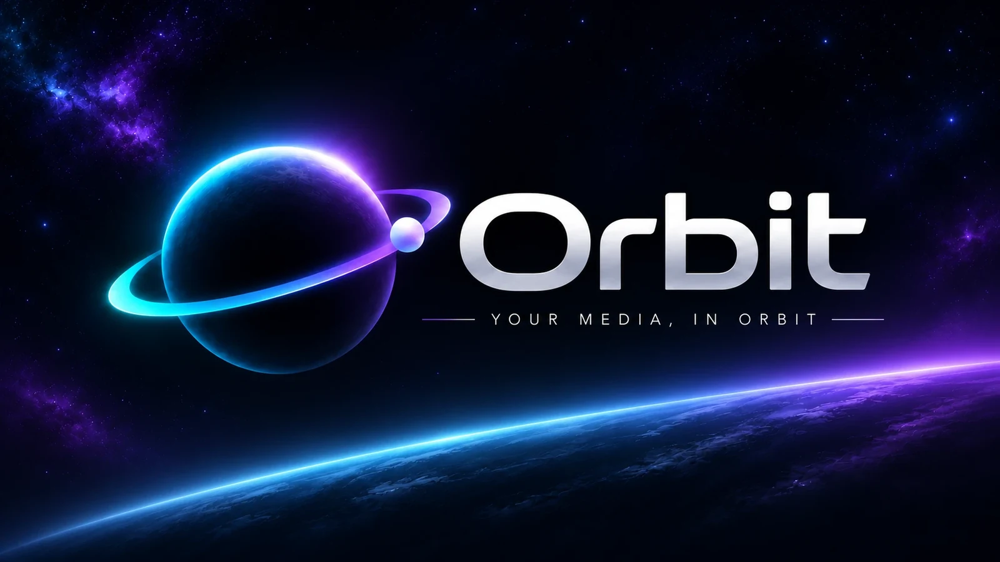

**A self-hosted home for live TV, films and shows, on your TV, phone, browser and computer.**

Orbit brings your IPTV service, your Plex and Jellyfin libraries and your Seerr requests together in one cinematic
app. A small home server you run yourself keeps the logins, accounts and profiles. Every screen in the house talks
only to that server, so the experience is the same on the TV in the living room, the phone in your hand and the
browser at your desk.

> Orbit is a **player only**. It ships no channels, streams, playlists or other content and is not affiliated with
> any provider. You add your own sources and must have the rights to watch them. Orbit is based on
> [tvBro](https://github.com/kmmarin/tvBro) (Apache-2.0).

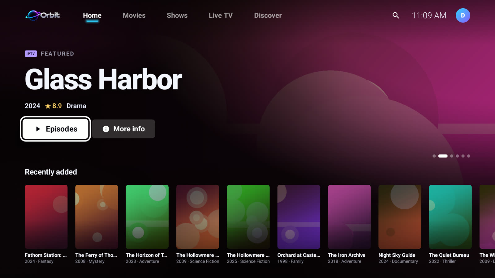

*Every screenshot on this page uses the fictional demo provider in [`tools/demo/`](tools/demo/): made-up channels,
titles and artwork.*

## What it does

| | |
|---|---|
| 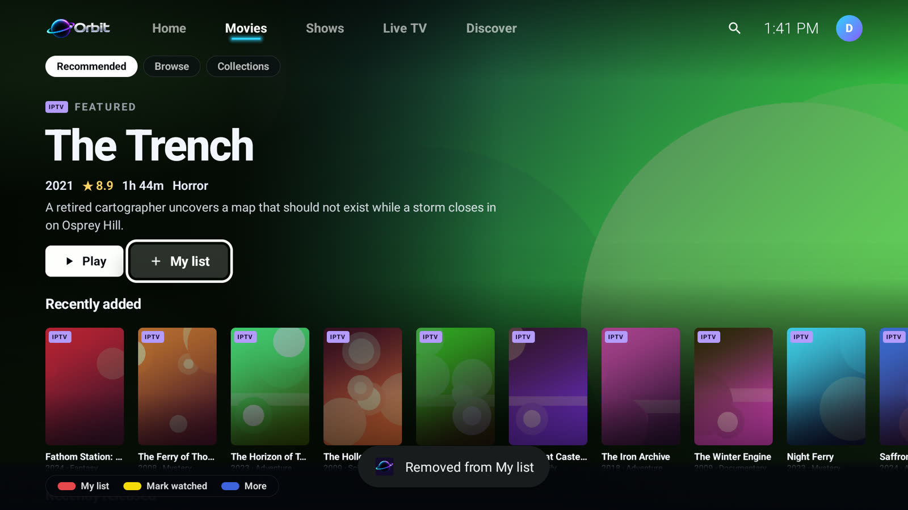 | 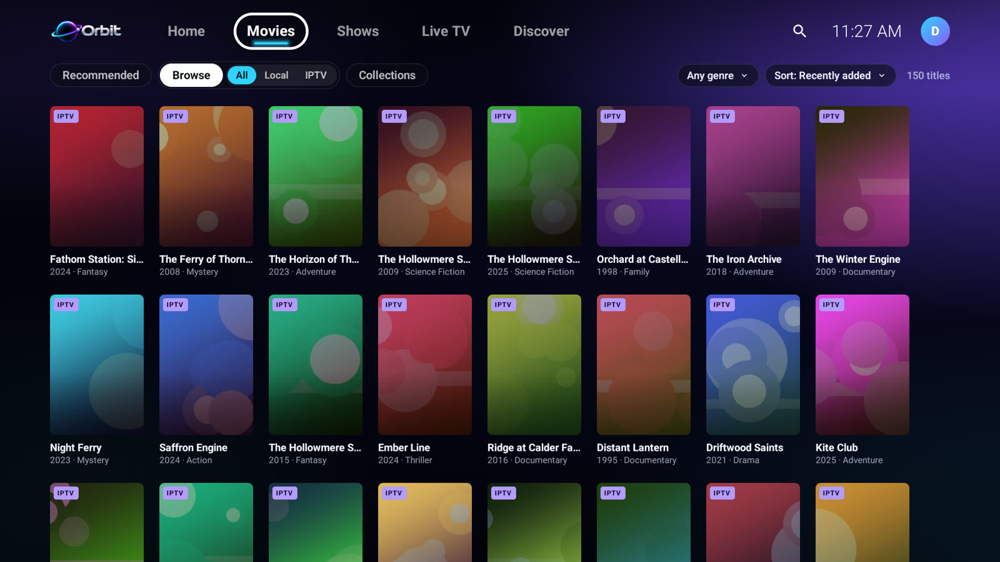 |
| **Movies and Shows.** Recommended rows (continue watching, recently added, top in a genre, top unwatched), then Browse and Collections, one press away. | **Browse.** All · Local · IPTV, genre, sort and the title count on a single row, above a poster grid that loads as you go. |
| 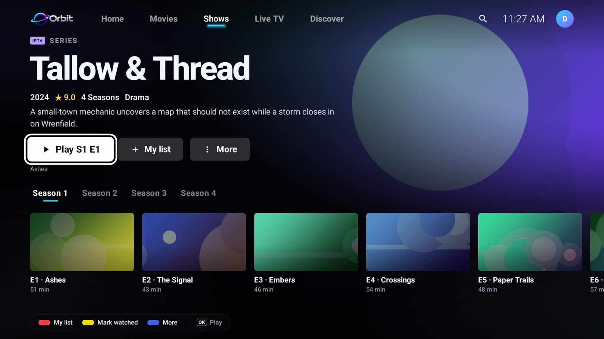 | 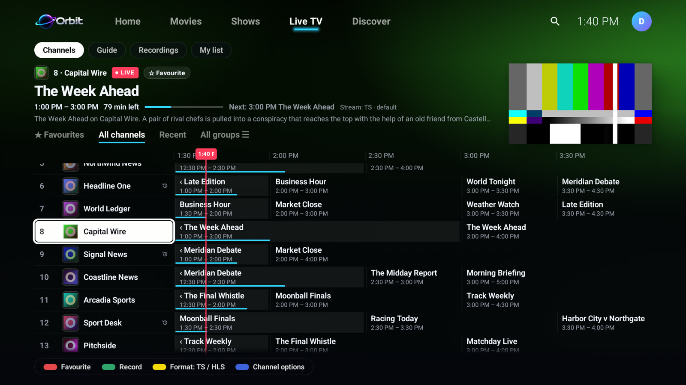 |
| **Title pages.** Play or resume first, seasons and episodes right below, and the remote's coloured keys for My list and Mark watched. | **Live TV.** A guide built for the remote: quick-select group tabs, a live preview, a now line and favourites. |
| 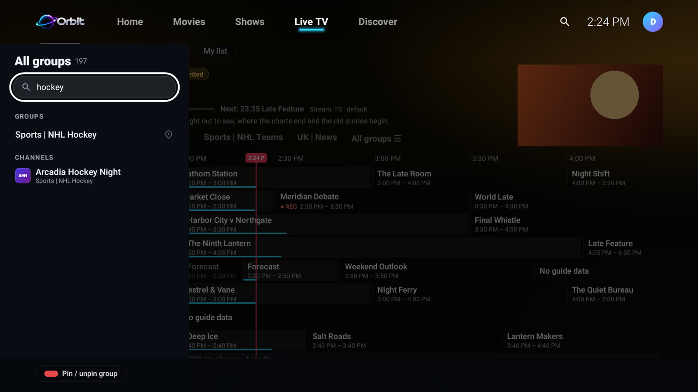 | 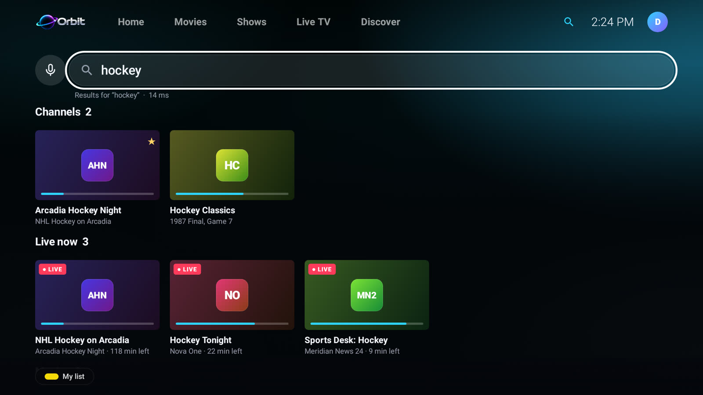 |
| **Thousands of channels, found fast.** Groups fold into folders ("Sports", "UK" …), a search box finds groups and channels, and the groups you pin become tabs. | **Search everything.** Channels, what's on now, films and shows, with voice search and history. |
| 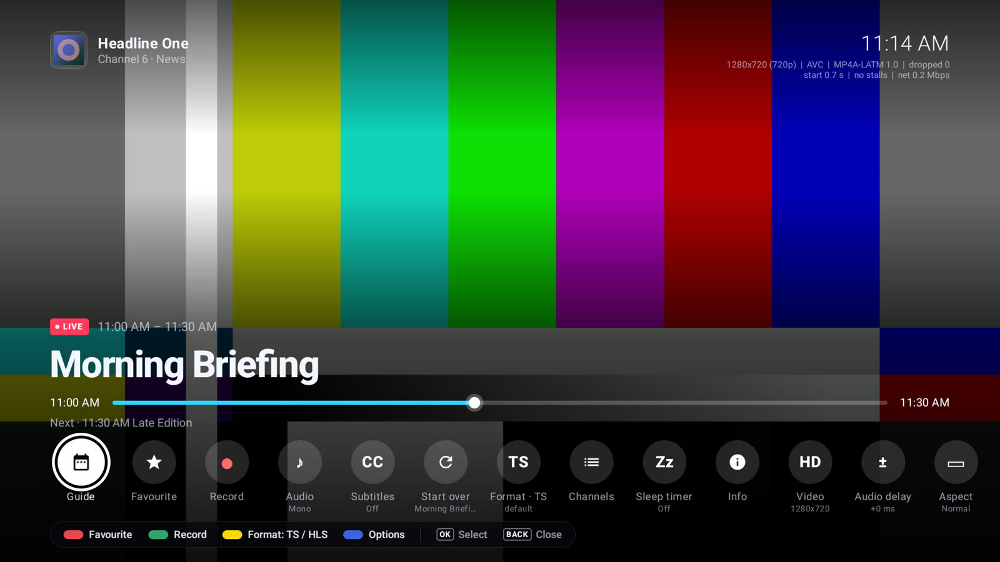 | 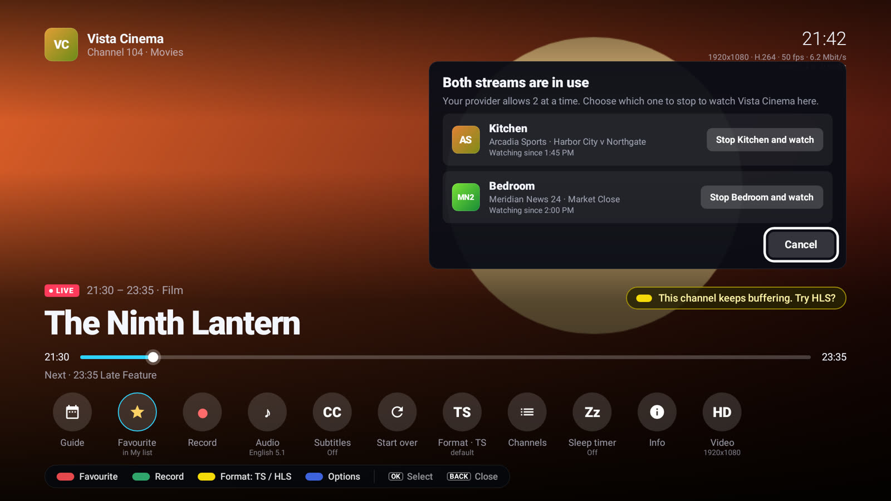 |
| **The player.** Guide, favourite, record, subtitles, audio, start over and per-channel MPEG-TS or HLS, all from one row. | **Fair sharing.** When every stream your provider allows is in use, choose which TV to stop, by name. A channel that keeps buffering offers HLS and never switches on its own. |
| 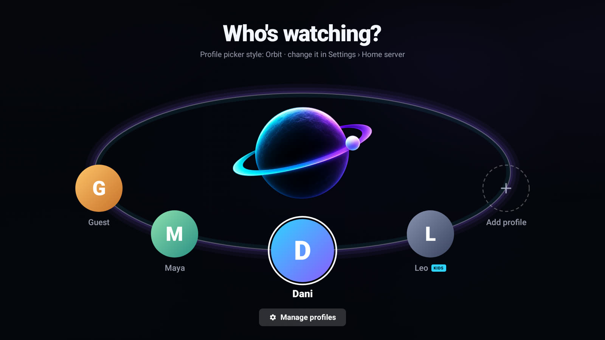 | 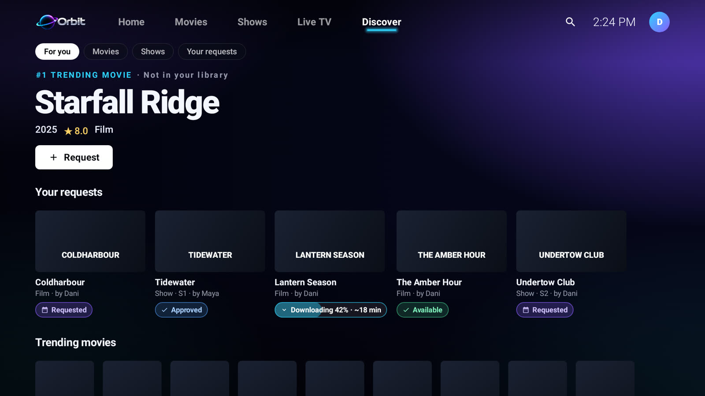 |
| **Accounts and profiles.** Everyone gets their own My list, progress and recommendations; kids profiles hide locked categories. Pick the orbit picker or a classic grid. | **Discover.** Trending and upcoming titles through Seerr. Requests show live status down to download progress, and titles you already have say Play. |

### In the browser and on your phone

| | |
|---|---|
| 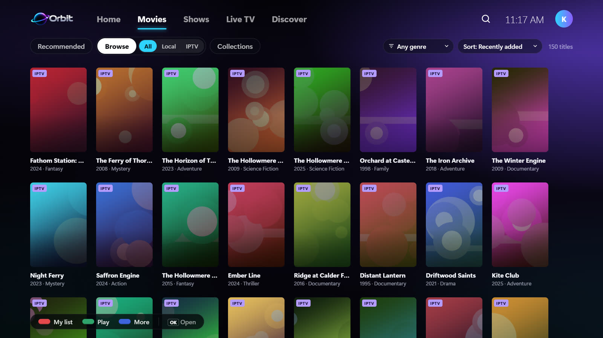 | 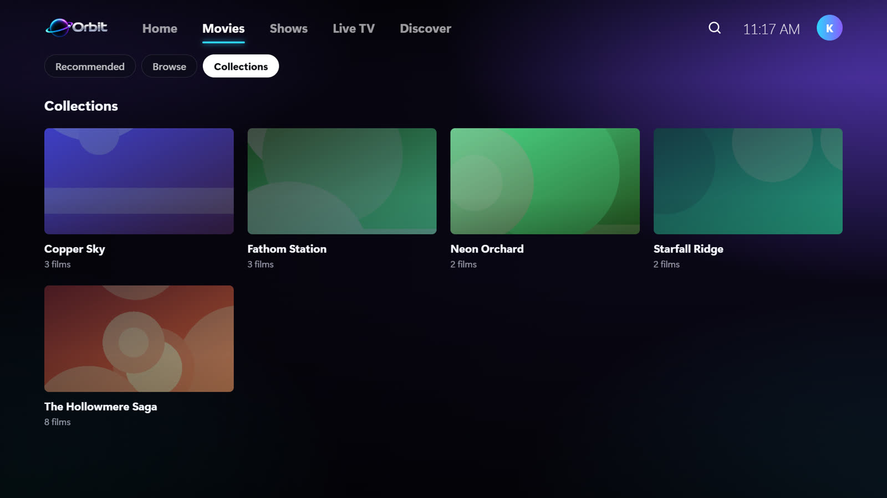 |

  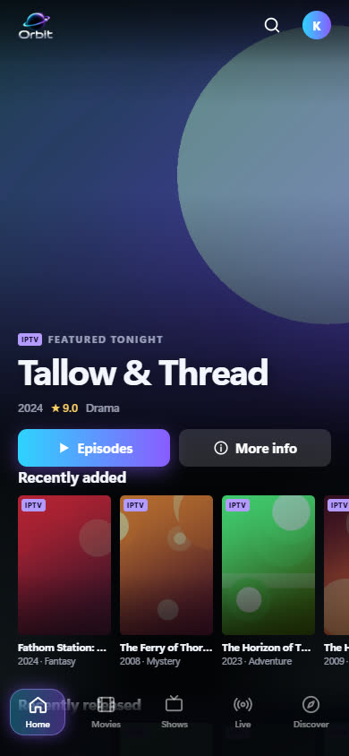
  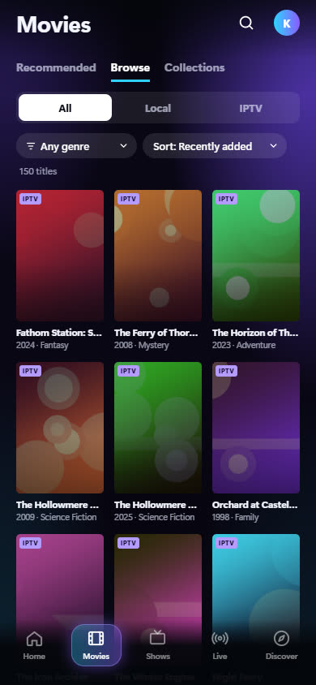
  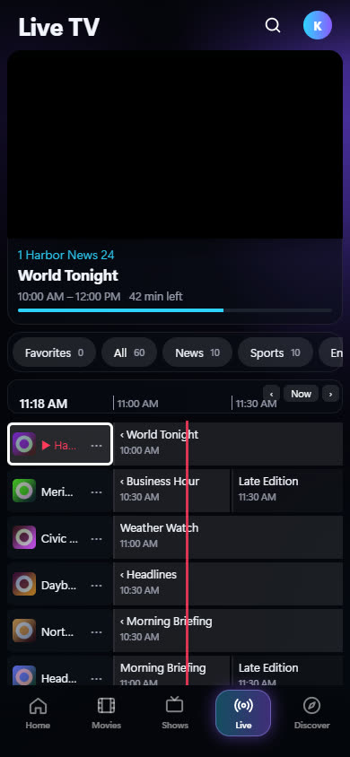

The web app is served by the home server, so there is nothing to install on a computer. Below 900 px wide, and in the
Android app on a phone, Orbit switches to a touch layout with a labelled bottom bar.

## How it fits together

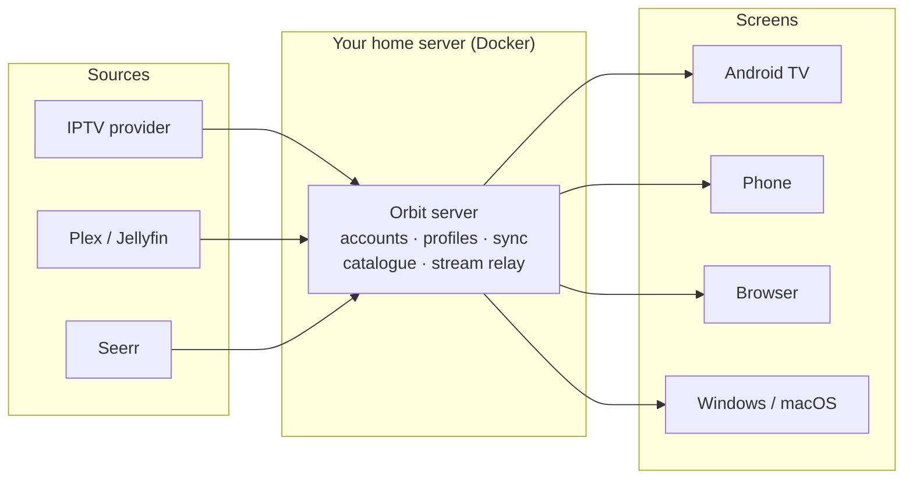

- **One home server** keeps the provider login, accounts, profiles, My list, resume points and show progress. It also
  serves the web app and builds the Home, Movies and Shows feeds.
- **Every screen talks only to the server.** A TV is linked once with a short code approved from a phone or computer;
  the desktop apps sign in with an account. Watching on one device picks up where another left off.
- **Provider logins stay on the server.** Each linked device gets a login of its own, which the owner can revoke, and
  the server relays the streams.

## Private by design

- **Runs at home.** On your own machine, reached over your home network or Tailscale. Nothing is published to the
  internet.
- **Every person apart.** Accounts and profiles, with each profile's data in its own file on the server.
- **Clean sign-out.** Signing a TV out from the web removes that account's data from the TV.
- **Name each TV.** Kitchen, Bedroom: devices are listed by name and can be renamed or unlinked from the web.
- **Hardened.** Throttled sign-in, session and pairing limits, no logins sent on redirects, and client addresses
  trusted only from proxies you list.

## Get Orbit

| Part | How |
|---|---|
| **Home server** | Docker on Linux. Copy [`infra/compose.example.yaml`](infra/compose.example.yaml), then follow [`docs/orbit/DEPLOY.md`](docs/orbit/DEPLOY.md) (setup token, first owner account, updates, backups, reverse proxy and TLS). |
| **Web app** | Open `http://<your server>:8750` in a browser once the server runs. |
| **Android TV and phones** | Build the APK (`./gradlew :app:assembleDebug`); signed release builds will be attached to [Releases](https://github.com/VisionsDivided/orbit/releases). On the TV, choose **Find my server** or type its address, then approve the code from the web app. |
| **Windows** | Build the installer (`./gradlew :desktop:packageMsi`). Add `libmpv-2.dll` for video; the app explains where to get it ([`docs/INSTALL.md`](docs/INSTALL.md)). |
| **macOS** | Every push builds a DMG in [Actions](https://github.com/VisionsDivided/orbit/actions) (Apple silicon and Intel). It is unsigned, so open it the first time with right-click ▸ Open. Status: [`docs/orbit/MACOS.md`](docs/orbit/MACOS.md). |

## Under the hood

| Part | Built with |
|---|---|
| Home server | Python standard library, SQLite, Docker |
| TV and phone app | Kotlin, Jetpack Compose, Media3 |
| Web app | Plain JavaScript, served by the home server, no build step |
| Desktop apps | Compose Desktop with libmpv (Windows and macOS) |
| API | One documented, versioned contract every app shares: [`docs/orbit/API-v1.md`](docs/orbit/API-v1.md) |

Tests: `py -3 -m unittest discover -s web/tests` (server), `node --test web/tests/*.test.mjs` (web) and
`./gradlew :shared:test :app:testDebugUnitTest :desktop:test` (Kotlin, including screen renders). The design is in
[`docs/orbit/DESIGN-SPEC-5.md`](docs/orbit/DESIGN-SPEC-5.md), the TV app's structure in
[`docs/orbit/TV-UI.md`](docs/orbit/TV-UI.md), and every change in [`CHANGELOG.md`](CHANGELOG.md).

## Status

Orbit is in active development (0.1.0-dev).

- **Working:** the home server, accounts and profiles, TV linking and sync, the TV, web and phone apps in the new
  design, Live TV with the guide, recordings, the stream limit, hidden provider logins and the Seerr screens.
- **Next:** Plex and Jellyfin playback on the TV and web (browsing works today), a run of the macOS app on a real Mac,
  and signed releases on GitHub.

## Credits and license

Orbit is built on [tvBro](https://github.com/kmmarin/tvBro), an open-source IPTV player by the tvBro authors, under
the Apache License 2.0. tvBro's original README is kept in [`docs/TVBRO-README.md`](docs/TVBRO-README.md), and its
notices are in [`NOTICE`](NOTICE). Fixes found while building Orbit are offered back to tvBro.

The code is licensed under [Apache-2.0](LICENSE). The Orbit name, logos and app icons in [`branding/`](branding/) are
the Orbit project's own artwork and are not covered by the code's license ([`branding/README.md`](branding/README.md)).
